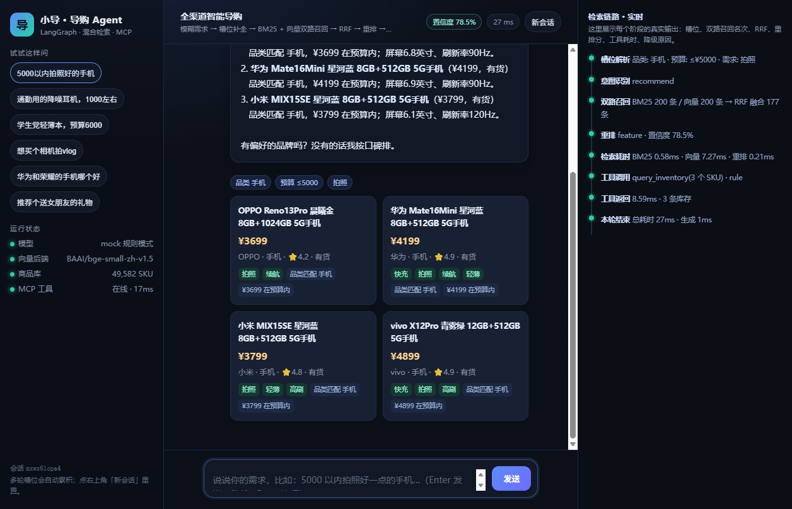

# 小导 · 全渠道智能导购 Agent

> 面向电商售前导购场景的 Agent 平台：**模糊需求 → 多轮槽位补全 → BM25 + BGE 双路召回 → RRF 融合 → 特征/CrossEncoder 重排 → MCP 库存校验 → SSE 流式回答**。

用户说一句「5000 以内拍照好一点的手机」，系统要能把这句话拆成结构化条件、在 5 万条 SKU 里召回候选、融合两路结果、按预算与需求重排、调工具确认真实库存，最后流式输出带商品卡片的推荐——这个仓库就是这套链路的完整实现，可以直接跑起来。

```
┌──────────┐   ┌──────────────┐   ┌───────────────────────────────┐   ┌──────────────┐
│ 浏览器    │──▶│ FastAPI      │──▶│ LangGraph 6 节点状态机          │──▶│ SSE 流式回答  │
│ 聊天页    │   │ /api/chat    │   │ understand→retrieve→(rewrite)→ │   │ meta/slots/  │
└──────────┘   │ /stream      │   │ plan→tool→respond              │   │ retrieval/…  │
               └──────────────┘   └───────────────┬───────────────┘   └──────────────┘
                                                  │
                        ┌─────────────────────────┼──────────────────────────┐
                        ▼                         ▼                          ▼
                 ┌──────────────┐        ┌────────────────┐         ┌────────────────┐
                 │ 混合检索      │        │ MCP Server     │         │ LLM 双模        │
                 │ BM25 + 向量   │        │ 库存/促销工具   │         │ DeepSeek / Mock │
                 │ RRF + 重排    │        │ 100ms 超时降级  │         │ 规则兜底         │
                 └──────┬───────┘        └────────────────┘         └────────────────┘
                        ▼
              SQLite 商品库（4.9 万 SKU） + 倒排索引 + 向量矩阵
```

## 能力清单（对应简历四条）

| 简历描述 | 代码位置 | 实现要点 |
|---|---|---|
| LangGraph 6 节点对话状态机、5 类槽位正则 + LLM 双通道抽取 | `app/agent/graph.py` `app/agent/nodes.py` `app/agent/slots.py` | 品类/品牌/预算/需求点/场景 5 类槽位；正则管硬字段、LLM 管语义，冲突时正则优先 |
| 5 万 SKU 清洗结构化，规格入 ES、语义入 Milvus，BM25 + BGE 双路召回 | `app/data/` `app/retrieval/` | 原始数据先做脏化再清洗（去重 1739 条、剔除非法 142 条）；本地用自研 BM25F + 向量矩阵，接口与 ES/Milvus 对齐 |
| RRF 融合、候选截断后重排 | `app/retrieval/fusion.py` `app/retrieval/pipeline.py` `app/retrieval/rerank.py` | RRF k=60；先按约束过滤再截断 30 条重排（顺序错了会推荐超预算商品） |
| MCP 库存工具 + Function Calling，超时降级，低置信度改写二次检索，SSE | `app/tools/` `app/agent/nodes.py` `app/api/chat.py` | 手写 MCP stdio server；100ms 超时回退商品库快照；置信度 < 阈值触发改写重检 |

## 快速开始

```bash
# 1. 依赖（Python 3.11+）
python -m venv .venv
.venv\Scripts\activate            # Windows；macOS/Linux: source .venv/bin/activate
pip install -r requirements.txt

# 2. 造数据：合成 5 万条 3C SKU → 清洗入库
python -m app.data.generator --count 50000
python -m app.data.etl

# 3. 起服务（首次会构建索引，约 50s；之后直接读缓存）
python -m app.main
# 或 uvicorn app.main:app --port 8771
```

打开 <http://127.0.0.1:8771> 就是聊天页。



右侧面板是这条链路的实时输出：槽位解析 → 双路召回条数 → RRF 融合 → 重排置信度 → 工具耗时，演示和排查都靠它。

**接真实模型**：复制 `.env.example` 为 `.env`，填 `LLM_API_KEY`（DeepSeek / 通义 / 任意 OpenAI 兼容端点）。不填也能跑——会自动切到 `mock` 规则模式，检索、工具、SSE 全是真实的，只有"生成"这一步换成模板。

```ini
LLM_API_KEY=sk-xxx
LLM_BASE_URL=https://api.deepseek.com
LLM_MODEL=deepseek-chat
```

## 目录结构

```
app/
├── main.py                 FastAPI 入口（lifespan 装配索引、图、MCP 子进程）
├── config.py               所有可调参数，环境变量覆盖
├── api/                    chat（SSE）/ catalog（商品、元信息）
├── agent/                  state / slots / prompts / nodes / graph / runner
├── retrieval/              bm25 / vector / fusion / rerank / pipeline / engine
├── tools/                  mcp_server（stdio JSON-RPC）+ inventory（客户端与降级）
├── llm/                    client（OpenAI 兼容）+ embeddings（fastembed/openai/hashing）
├── data/                   taxonomy（领域知识）/ generator（合成）/ etl（清洗）
├── eval/                   dataset（评测集构造）/ runner（Recall/MRR/nDCG）
├── store/                  SQLite：商品、会话、工具调用日志
└── core/                   日志、事件、文本工具
web/index.html              单文件聊天页（零构建，SSE + 商品卡片 + 链路面板）
scripts/                    build_index / eval_ablation
tests/                      25 项单测与链路测试
```

## 关键设计

### 1. 槽位双通道：正则管硬信息，模型管语义

价格、品牌、品类这些字段一旦被模型"幻觉"成 5499，后面全错。所以：

- 正则通道负责 `5000以内` `3000到4000` `5k左右` `不要小米` 这类结构稳定的表达；
- LLM 通道只补语义：`拍照好` → `拍照`，`想送女朋友` → `scene=送礼`；
- 合并时数值与品牌以正则为准，属性取并集，否定约束只增不减（`app/agent/slots.py:merge_slots`）。

多轮里还会做两件容易被忽略的事：**品类切换时清空上一个品类的需求点**（"降噪"对手机没意义），以及**"再便宜点"要真的把预算打七折**（`app/agent/nodes.py:understand`）。

### 2. 检索：先过滤，再截断，最后重排

最初的实现是"召回 50 → RRF → 截断 30 → 过滤约束"，评测里发现一个典型 bug：查「拍照好的手机，预算 2700」，池子里前 30 条全是 4000+ 的机器，过滤后为空，只能整体放宽预算 → **推荐了 6699 的手机**。

修正后：召回扩到 200/路，**在融合后的大池子上先做硬约束过滤，再截断到 30 条重排**。这条查询的 recall 从 0 恢复到正常水平（关键词子集整体 0.889，`app/retrieval/pipeline.py` 里那段注释就是这个坑）。

### 3. 置信度不是拍脑袋的常数

```
confidence = 0.55 × top1重排分 + 0.15 × 头部区分度 + 0.30 × 约束覆盖率
```

三个分量分别回答：最相关的那条到底有多相关？它和第二条拉得够开吗？品类/品牌/价格这些硬条件在前三条里满足了吗？低于阈值就触发 Query 改写 + 二次检索，最多一次，避免死循环。

踩过的坑：一开始重排分用"批内归一化"，每次查询的 top1 都是 1.0，置信度永远 0.9+，改写逻辑等于没写。改成绝对分（BM25 用 `1-exp(-score/10)` 饱和映射，余弦用经验区间拉伸）之后，"帮我写一首诗"的置信度掉到 0.33，系统才会去澄清而不是硬推荐。

### 4. MCP 工具：常驻子进程 + 100ms 熔断 + 快照降级

MCP server 是手写的 stdio JSON-RPC（`initialize` / `tools/list` / `tools/call`），不依赖官方 SDK，好处是协议细节一目了然。为了 100ms 超时有意义，server 是**常驻子进程**——每次调用现起一个 Python 进程，光启动就 300ms。

调用超时或进程挂了，`InventoryService` 自动回退到商品库里的静态库存，并在回答里明确告诉用户"实时库存接口超时，下面是快照"，而不是假装成功。

### 5. SSE 事件协议

```
meta → slots → intent → retrieval → [rewrite] → tool_call → tool_result → delta… → products → done
```

每个事件都是独立 JSON，前端按 `event:` 名分发；`delta` 只带增量文本，商品卡片单独走 `products`，这样卡片不会跟着流式文本被重复渲染。

## 评测

评测集不是死答案，而是"约束 → 相关集"：商品库里所有满足品类/品牌/价格、且标签命中需求点的 SKU 都算相关。为了让指标有区分度，数据集构造时会**主动收紧约束**，把相关集控制在 5~120 条（相关集几千条时任何 top10 都是满分，指标恒为 1.0）。

查询分两类，分开统计才有意义：

- **keyword（46 条）**：查询里直接出现品类/品牌/卖点词，检验精确匹配；
- **semantic（6 条）**：查询里**不出现**卖点词（"地铁通勤想把噪音隔掉"），只能靠语义召回。

`python scripts/eval_ablation.py`（4.96 万 SKU，BGE 向量）：

| 配置 | 全部 Recall@10 | 关键词 Recall / nDCG | 语义 Recall / nDCG | 检索延迟 |
|---|---|---|---|---|
| 仅 BM25 | 0.883 | **0.924** / **0.941** | 0.567 / 0.577 | 1.2 ms |
| 仅向量 | 0.842 | 0.870 / 0.888 | 0.633 / 0.676 | 6.0 ms |
| 双路 RRF（不重排） | 0.865 | 0.891 / 0.884 | 0.667 / 0.669 | 10.1 ms |
| **双路 + 重排**（默认） | 0.867 | 0.889 / 0.909 | **0.700 / 0.725** | 10.5 ms |

怎么读这张表：

- **关键词型查询 BM25 最强**。在"品牌 + 型号 + 参数"这类精确表达上，字面匹配本来就是最优解，双路反而会带进一点语义噪声（0.924 → 0.889）。
- **语义型查询双路明显更好**（0.567 → 0.700，+13 个点），这正是线上"想买个能拍月亮的手机"这类表达的场景。RRF 里向量权重设成 0.6 就是这个折中的结果——权重扫描显示 0.6 时两边都不吃亏。
- 所以默认开双路，但两路权重、RRF k、重排权重全部可配（`.env` 里 `RRF_WEIGHT_VECTOR` 等），接真实流量后应按查询类型动态调。

> 延迟是检索链路本身（BM25 + 向量 + RRF + 重排，不含 LLM 生成），本机 CPU。

### 重排：特征 vs CrossEncoder

`python scripts/eval_rerank.py --queries 16`（同一批查询，只换重排器）：

| 重排器 | Recall@10 | nDCG@10 | MRR@10 | 单次延迟 |
|---|---|---|---|---|
| 特征重排（默认） | 0.856 | 0.877 | 0.938 | 12 ms |
| BGE CrossEncoder（bge-reranker-base） | **0.919** | **0.941** | **1.000** | 1434 ms |

结论很实际：CrossEncoder 用 **100 倍延迟换 6 个点召回**，所以默认关着，`RERANK_MODE=cross_encoder` 才启用；线上更合理的做法是按流量采样、或只对打分边界附近的候选做二次重排。

另一个踩过的坑：CE 的输入必须带价格和核心参数。只喂"标题 + 标签"时它分不清"5000 以内"和"6000 起"，nDCG 反而从 0.877 掉到 0.842；把价格、规格拼进 passage 之后才变成上表的 0.941。

## 接口

| 方法 | 路径 | 说明 |
|---|---|---|
| POST | `/api/chat/stream` | SSE 流式对话（浏览器用 fetch 读流） |
| GET | `/api/chat/stream?q=&session_id=` | EventSource 兼容版本 |
| POST | `/api/chat` | 一次性返回 answer / slots / products |
| GET | `/api/products/{sku_id}` | 商品详情 |
| GET | `/api/search?q=` | 无状态检索（不走 Agent） |
| GET | `/api/meta` | 索引统计、模型状态、工具成功率、阈值 |
| DELETE | `/api/chat/session/{id}` | 重置会话 |
| GET | `/api/chat/health` | 健康检查 |

```bash
curl -N -X POST http://127.0.0.1:8771/api/chat/stream \
  -H "Content-Type: application/json" \
  -d '{"query":"5000以内拍照好的手机","session_id":"demo"}'
```

## 部署

```bash
docker compose up -d --build
# 或
docker build -t shopping-agent .
docker run -p 8771:8771 -v ./data:/app/data shopping-agent
```

镜像首次启动会自动造数（5 万条，约 15s）、清洗、建索引（hashing 向量约 25s），`data/` 挂卷后第二次启动直接读缓存。

**网络受限时**：基础镜像与 pip 源都做成了构建参数，换成可达的镜像站即可——

```bash
docker build \
  --build-arg BASE_IMAGE=docker.m.daocloud.io/library/python:3.12-slim \
  --build-arg PIP_INDEX_URL=https://pypi.tuna.tsinghua.edu.cn/simple \
  -t shopping-agent .
```

（本机验证时 `docker compose config` 通过、Dockerfile 解析通过，但 Docker Hub 的 blob 请求被网络拦截返回 HTML，镜像未能实际构建完成——这是网络问题，不是文件问题。）

## 测试

```bash
python -m pytest -q      # 28 passed
```

覆盖：分词/价格解析、槽位抽取与多轮合并、RRF 排序性质、预算与品牌硬过滤、MCP 往返、库存降级、Agent 全链路事件、闲聊与售后短路，以及用 `httpx.MockTransport` 验证的 OpenAI 兼容协议层（JSON 模式 / Function Calling / 流式）。

## 已知局限

- **默认向量后端**：本机装了 `fastembed`，用的是 `BAAI/bge-small-zh-v1.5`（512 维）；没装则自动退回零依赖的 hashing embedding，语义能力有限但链路完整。
- **ES/Milvus 只留了接口位**：本机没有 Docker，默认跑本地索引；`app/retrieval/` 的 BM25 与向量实现都是独立类，替换成 ES/Milvus 不需要改 pipeline。
- **CrossEncoder 重排需要下载 1GB 级模型**，默认关；`RERANK_MODE=cross_encoder` 打开，加载失败自动退回特征重排。
- 商品数据是合成的（规则贴近真实市场，但不是真实商品），用于演示与压测链路，不用于线上选品。
- 语义查询评测集只有 6 条，样本偏少，结论方向可信、幅度仅供参考。
